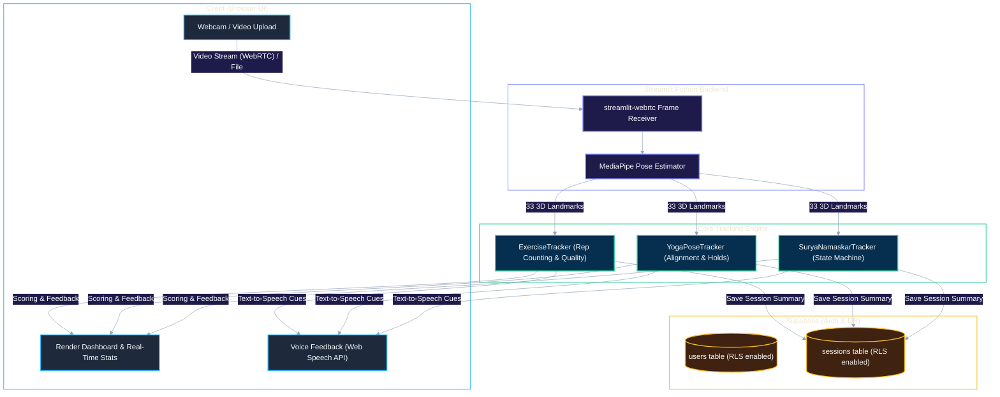

<div align="center">

# Arogya Vision

**Smart Fitness Trainer — Real-time AI Coaching & Posture Correction**

[](https://smart-fitness-trainer.streamlit.app)
[](https://python.org)
[](https://mediapipe.dev/)
[](https://supabase.com/)
[](LICENSE)

<br/>

*Real-time kinematics analysis · Multi-signal rep-quality gating · Voice feedback · OAuth & RLS Security*

*Powered entirely by Python, Streamlit, and MediaPipe — no external API calls for pose estimation.*

<br/>

[**Try the Demo →**](https://smart-fitness-trainer.streamlit.app) · [Architecture](#architecture) · [Tracking Logic](#tracking--scoring-logic) · [Get Started](#getting-started)

---

</div>

> [!CAUTION]
> **Before using the live demo**, note that the app is hosted on a free tier that spins down when idle. 
> The application might take up to 60 seconds to wake up upon your first visit.

> [!NOTE]
> Arogya Vision runs completely natively in Python using `streamlit-webrtc` for zero-latency camera streams and local MediaPipe models for pose estimation. 
> All session data and authentication is securely backed by Supabase with Row Level Security (RLS) enforcement.

---

## Table of Contents

<details>
<summary><b>Click to expand</b></summary>

1. [Why Arogya Vision](#why-arogya-vision)
2. [Architecture](#architecture)
3. [Sample Output](#sample-output)
4. [Tracking & Scoring Logic](#tracking--scoring-logic)
5. [Getting Started](#getting-started)
6. [Security Architecture](#security-architecture)
7. [Project Structure](#project-structure)
8. [Contributors](#contributors)
9. [License](#license)

</details>

---

## Why Arogya Vision

Most computer-vision fitness apps rely on basic joint-angle thresholds that struggle with variations in body proportions. Arogya Vision implements a deterministic, multi-signal grading engine:

| Principle | How It's Achieved |
|:---|:---|
| **Multi-Signal Gating** | Reps are evaluated against Tempo, ROM completion, and Stability (posture control) via a robust base score + penalty gate override system. |
| **Local-first CV** | Pose estimation (MediaPipe) runs strictly on the host environment; no video frames are ever sent to an external API. |
| **Real-time Feedback** | Integrated voice coaching via Web Speech API provides immediate, actionable form correction mid-set. |
| **Secure by Default** | Full Google OAuth integration paired with Supabase Row Level Security (RLS). You can only query your own session history. |
| **Versatile Training** | Supports 5 distinct dynamic exercises (with rep counting) and 6 static yoga poses (with a guided Surya Namaskar sequence). |

---

## Architecture

### End-to-End Data Flow



---

## Sample Output

When an exercise completes, the core engine deterministically grades the repetition quality across multiple vectors (tempo, ROM, stability). Base scores are calculated via multi-variable algorithms, and hard quality gates apply strict penalties (capping scores at 45, 35, or 25) if form breaks down entirely.

Below is the actual telemetry output produced by the `ExerciseTracker` rep-quality gating engine. Note how a fast, unstable push-up triggers the strict stability and tempo gating penalties:

```text
=======================================================
TELEMETRY REPORT FOR: PUSHUPS
=======================================================
--> [CLEAN REP TEST]:
    Duration        : 1.50s (Min Req: >= 1.0s)
    ROM Travel Span : 80.0 deg (Min Req: >= 45.0 deg)
    Extreme Angle   : 80.0 deg (Target: <= 100.0 deg)
    Max Stability Delta : 2.0 deg (Max Tol: <= 15.0 deg)
    Failed Gates    : []
    Resulting Score : 99.3 / 100
    Classification  : CLEAN REP

--> [BAD REP TEST (Fast/Shallow/Swinging)]:
    Duration        : 0.35s (Min Req: >= 1.0s)
    ROM Travel Span : 60.0 deg (Min Req: >= 45.0 deg)
    Extreme Angle   : 98.0 deg (Target: <= 100.0 deg)
    Max Stability Delta : 25.0 deg (Max Tol: <= 15.0 deg)
    Failed Gates    : ['tempo', 'stability']
    Resulting Score : 34.8 / 100
    Classification  : BAD REP
```

This strict gating structure completely isolates user behavior—such as half-reps or momentum jerking—causing bad reps to be safely logged in the user's history without inflating their average session scores.

---

## Tracking & Scoring Logic

Arogya Vision avoids generalized heuristics by implementing strict configuration limits. State machines manage transitions (e.g., `START` → `DESCENDING` → `BOTTOM` → `ASCENDING`), ensuring that a repetition is only valid if the full kinematic sequence is executed.

*   **Dynamic Exercises**: Squats, Pushups, Lunges, Bicep Curls, Shoulder Press.
*   **Yoga Poses**: Mountain Pose, Tree Pose, Warrior II, Chair Pose, Triangle Pose, Warrior I. (Also includes a state-managed guided Surya Namaskar sequence using fallback/timed-transition steps).

---

## Security Architecture

This application processes sensitive health and personal data. We have implemented several production-grade security gates:
*   **Supabase Row Level Security (RLS)**: Users securely authenticate via Google OAuth (PKCE verifier leak patched). Postgres RLS policies guarantee users can only `SELECT`, `INSERT`, or `UPDATE` their own session history.
*   **Safe Query Layer**: All queries use the Supabase JS/Py client interface natively, mitigating SQL injection risks.
*   **Upload Rate Limiting & Limits**: Video analysis endpoints enforce strict file size checks and processing chunk limits to prevent OOM attacks and server degradation.

---

## Getting Started

### Local Development Setup

```bash
# 1. Clone and navigate to the project
git clone https://github.com/Varora-24/Smart-Fitness-Trainer.git
cd Smart-Fitness-Trainer

# 2. Set up the Python virtual environment
python -m venv venv
# On Windows: venv\Scripts\activate
# On macOS/Linux: source venv/bin/activate

# 3. Install dependencies
pip install -r requirements.txt

# 4. Configure Supabase Environment
mkdir .streamlit
cp .streamlit/secrets.toml.example .streamlit/secrets.toml
# Add your SUPABASE_URL and SUPABASE_ANON_KEY to .streamlit/secrets.toml

# 5. Run the Streamlit application
streamlit run app/Home.py
```

### Run Tests

```bash
# Run the test suite (currently passing 70/70 assertions)
pytest tests/ -v
```

---

## Project Structure

<details>
<summary><b>Click to expand full project tree</b></summary>

```text
Smart-Fitness-Trainer/
├── app/
│   ├── Home.py                       ← Streamlit dashboard and central navigation (entry point)
│   └── pages/
│       ├── 1_🔴_Live_Trainer.py      ← Real-time webcam exercise coaching
│       ├── 2_📊_History.py           ← User session trends and charts
│       ├── 3_📹_Video_Analysis.py    ← Offline asynchronous video processing
│       ├── 4_🥗_Nutrition.py         ← TDEE and Macro calculators
│       ├── 5_💊_Supplements.py       ← Goal-based supplement educational guide
│       └── 6_🧘_Yoga.py              ← Pose alignment scoring and Surya Namaskar sequence
│
├── core/
│   ├── tracking/
│   │   ├── exercise_classifier.py    ← Automatic detection of active exercises
│   │   ├── exercises.py              ← State machine logic and quality gating for dynamic reps
│   │   ├── frame_pipeline.py         ← WebRTC orchestrator connecting CV to tracking logic
│   │   ├── pose_module.py            ← MediaPipe skeleton wrapper and geometry maths
│   │   ├── surya_namaskar_tracker.py ← Multi-step sequence tracker for Sun Salutations
│   │   └── yoga_tracker.py           ← Static hold alignment threshold scoring
│   ├── data/
│   │   ├── db.py                     ← Supabase client interactions (sessions, users)
│   │   └── nutrition.py              ← Mifflin-St Jeor equation implementations
│   └── utils/
│       ├── auth.py                   ← PKCE-secured Google OAuth flows
│       └── icons.py                  ← Lucide SVG injection utilities
│
├── tests/                            ← 70-test suite covering gating, auth, DB, and pose maths
├── requirements.txt                  ← Production dependencies
└── pyproject.toml                    ← Build and test configurations
```

</details>

---

## Contributors

| Contributor | Responsibilities |
|:---|:---|
| **AI-Assisted Development** | Code architecture, CV pipeline implementation, refactoring, and security auditing (via Google Antigravity). |
| **Project Owner / Director** | System requirements, strategic planning, feature selection, and AI direction. |

---

## License

MIT — see [`LICENSE`](./LICENSE).

---

<div align="center">

### Precision Computer-Vision Fitness. Local, Fast, Secure.

*Deterministically tracked reps · Multi-signal form analysis · Secure authentication*

<br/>

Star this repo if you found it interesting!

---

*Made with AI-assisted development.*

</div>
